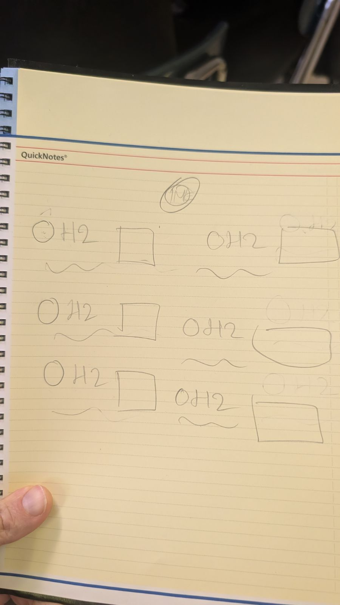

# My business and component plan

Complete this in your own words before asking an assistant to implement a component.

## 1. Choose and observe

- Business name and town: Industrial Motions Engineering, Wilmington MA
- Original website URL and date visited: Accessed November 18, 2026, [Link](https://industrialmotions.com/)
- Why this is a suitable independent local business: Because Angel works there, and because Angel and Hillary decided together that the ebsite homepage could be improved
- Reference screenshot(s): [Original homepage](reference/original-homepage.png)
- What a visitor most needs to do: The visiors need to get products fix on time
- Existing branding: logo, colors (hex codes), typography, images:
Images: Wheel, Shield, Trianguler ruler and protractor, saw machine, and a circle aroung the wheel
Typography: font-family: 'Unica One', cursive; for H1, font-family: 'Titillium Web'; for p, margin as well
Colors: black, #2C9DF4, #f5f5f5.
Logo: 

- What works in the original:
- Specific opportunities for a significant upgrade (hierarchy, typography, spacing, navigation, or finding key information):

## 2. Sketch and define components

Add or link a labeled sketch. Show both phone and laptop layouts.

Define at least three meaningful components. Add rows as needed; use names appropriate to your business.

| Component/file | Responsibility | Props (names and example values) | Where used / parent | Repeated? |
| --- | --- | --- | --- | --- |
| `src/lib/ProcessStepCard.svelte` | Displays one manufacturing process step with a badge/circle, heading, description, and photo | `stepNumber="1"`, `title="Concept"`, `description="..."`, `imageSrc="..."`,| `App.svelte` | 6 times |
|`src/lib/SiteHeader.svelte`| Shows the company's logo |`logoSrc="images/ime-logo.png"`, `businessname="Industrial Motions Engineering"` |` App.svelte` | No
|`src/lib/OurPhilosophyQuote.svelte`|Talks about what the compny believes in and its goal | `quote="", author="Joe Fustolo, Jr., Owner"`| `App.svelte`| No

- Which component contains which? Add a small component tree: 
Website
├── Header
├── The Process
│   └── ProcessItem(one item per process)
└── Author
- Which component will appear multiple times (at least twice) with different props?
src/lib/ProcessStepCard - 6 times
- What belongs in its props? What should stay in the component's shared markup and styles?
The props are the titles, the button circles, the descriptions, and an image beside it.
- First component I will build, and why: I will build the src/lib/ProcessStepCard because it has the most components. And also because it's the biggest chunk of our layout.

## 3. Build, test, revise

- Today: what did I render, and where is the working link?
- One change to a component that updated every instance:
- Phone and laptop checks (record at least two widths, problems, and revisions):
- Keyboard check:
- Before-and-after screenshots (link here):[Original homepage](reference/original-homepage.png) and [New homepage]
- Specific improvements over the original and how they help visitors:
- Partner feedback and what I changed:
- One component and its props, explained in my own words:
- Next milestone:

## Optional collaboration

If working together, agree on component props before splitting work.

| Person | Component ownership | Files | Integration checkpoint |
| --- | --- | --- | --- |
| | | | |

Keep one person responsible for integrating App.svelte. Test each component with sample props before combining work.
